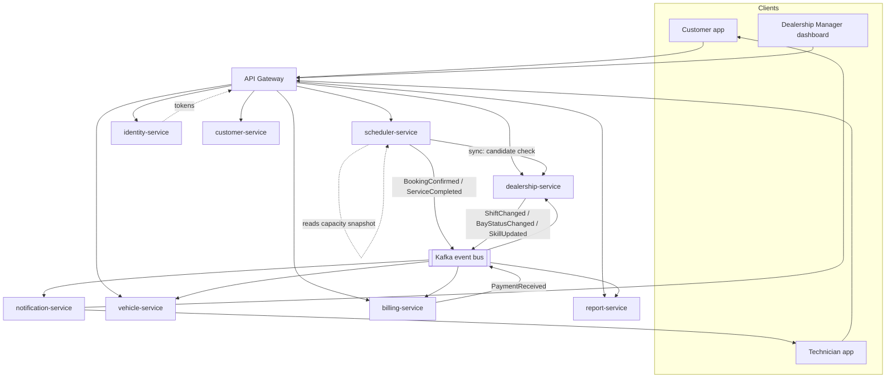

# Architecture Design — Microservices

Target service decomposition for Service Bay, built from `business-requirement.md` §2–3 and the actor/entity list there. Infra assumptions match the existing `docker-compose.yml`: PostgreSQL, Kafka, Redis.

Most of this document is the **target** design. §0 says how much of it is built.

---

## 0. Implementation status (2026-10-15)

| Part of the design | Status |
|---|---|
| identity-service | Built: register, login, refresh, logout, `GET /me`, admin user provisioning and status changes. Publishes `UserCreated` and `UserUpdated` (§3a). |
| customer-service | Built: customer CRUD, cursor pagination, optimistic locking, soft delete. Publishes the §3c events. Consumes `identity.user-events`: every `CUSTOMER` user gets a profile linked by `user_id` (an existing customer with the same email is claimed, otherwise one is created), readable at `GET /customer/me`. |
| vehicle-service | Built: registry, owner assign/transfer, warranty, installed materials, service history. Produces and consumes the §3b events. Consumes `identity.user-events` but only logs them for now. |
| scheduler-service | Built: hubs, service catalog, free-slot search, booking, a customer's own appointments and cancellation. Bay double-booking is prevented by the exclusion constraint (§4); vehicle double-booking by a per-vehicle advisory lock plus an overlap check. Checks the caller's profile and vehicles synchronously (§4 option 1). Publishes the §3d events. Its hub/bay/catalog tables are a local snapshot (§5b) filled from the dev seed until dealership-service exists. Staff can list a hub's day and mark an appointment completed, which publishes `ServiceCompleted` (§3b) with per-service prices (§3e). No check-in, start or technician assignment yet. |
| billing-service | Built (Java 25 / Spring Boot): deposits at booking, bills priced from `ServiceCompleted` (warranty fee by vehicle-service's answer), paying the balance, Stripe PaymentIntents and webhooks, reads, JWT auth. Consumes and produces the §3e events. Not yet: material costs (no `MaterialsConsumed` until dealership-service exists), refunds and disputes (#89), reconciliation (#91). |
| dealership, notification, report services | Not built. Each has a database and schema in `postgres/init/` (`04`, `07`, `08`) and nothing else yet. |
| API Gateway (§2, §7) | Not built. The web app (`frontend/`) calls each service directly, and the services allow any CORS origin. Each service verifies identity-service's access tokens itself (shared HS256 secret). |
| Transactional outbox (§3) | Built in all four Go services and billing-service: outbox row in the same transaction, relay polls every 2 s. billing's relay holds a Postgres advisory lock per pass, so only one replica publishes. |
| Database per service (§5, §7) | Built: one Postgres instance, one database per service, no cross-database FKs. |
| Ids (§5a) | Partly as designed. identity-service mints UUIDs; customer-service and vehicle-service still use `BIGINT` identity keys, and cross-service references (`customer_vehicle.customer_id`, `vehicle_material.material_id`, …) are `BIGINT` too. Customer profiles store the identity `user_id` (§3a). scheduler-service's ids are `BIGINT` too. |
| Redis (§7) | Used for identity-service refresh tokens and a 30 s cache of customer list pages. No availability cache yet: scheduler-service answers availability from Postgres. |
| Kafka (§3, §7) | One broker (KRaft in Docker Compose, ZooKeeper in `k8s/`), auto-created topics. |
| Data warehouse (§9) | Designed in `data-warehouse-design.md` (Kimball, CDC with Debezium, dbt). Not built. |

---

## 1. Service Map

| Service | Owns (data) | Responsibility |
|---|---|---|
| **identity-service** | User, Credential, Role | Auth/session for Customer, Technician, Dealership Manager, Admin. Everything else trusts its tokens. |
| **customer-service** | Customer (profile, contact) | Customer account management only. No vehicle data. |
| **vehicle-service** | Vehicle, Warranty | Vehicle registry, ownership link (`customer_id`), warranty status. Builds a per-vehicle service-history read model from scheduler events. |
| **dealership-service** | ServiceHub, ServiceBay, Technician, Skill, TechnicianSkill, Material (inventory), ServiceCatalog (service type, required skill, duration, price) | Everything a hub manages day-to-day: capacity, staffing, stock, catalog. Runs its own consumers for skill progression and inventory decrement (see §5). |
| **scheduler-service** | Booking/Appointment, a local capacity read-model (bay/technician/shift/skill snapshot) | Booking lifecycle: availability search, slot hold/confirm, cancellation, mid-service change requests. The only service that decides whether a slot is taken. |
| **billing-service** | Bill, Payment, Deposit | Bill computation (warranty fee + service fees + material cost) and payment/deposit handling. |
| **notification-service** | Outbox/delivery log | Delivers booking confirmations, mid-service approval prompts, bill-ready notices — email/SMS/push. Consumes the outbox topic, doesn't originate business logic. |
| **report-service** | Daily rollups per hub (read model) | End-of-day aggregation for Dealership Managers: revenue, completed bookings, materials consumed, technician utilization. Serves the `mart_daily_hub_report` built by the data warehouse (§9) instead of computing its own rollup. |

No standalone `worker` or `vehicle+material` service — see §5 and §1a for why those two ideas from the original list are folded in elsewhere.

### 1a. What changed from the original six

- **Vehicle** moved fully into vehicle-service (not split with customer-service's `customer_vehicle`).
- **Material** moved from vehicle-service into dealership-service — it's hub inventory, not a vehicle attribute (business-requirement §8).
- **Billing** and **identity** added — both were implied by §6 and §2 but had no owner.
- **notification-service** added — required for the mid-service approval flow (§5.6) to actually reach the customer.
- **worker** removed as a standalone service. A service that reaches into another service's tables from outside is the coupling you're trying to avoid by splitting in the first place. Its two jobs move to where the data already lives (§5).

---

## 2. Diagram



---

## 3. Communication: sync vs. async

**Synchronous (request/response), kept to a minimum:**

- Gateway → every service, for direct reads/writes initiated by a user action.
- scheduler → dealership-service, at booking time, to fetch candidate `(bay, technician)` pairs. This is the one cross-service call in the hot path — see §4 for why it's bounded and safe to get slightly wrong.

**Asynchronous (Kafka), for everything that isn't a direct user request waiting on an answer:**

| Event | Producer | Consumers | Purpose |
|---|---|---|---|
| `BookingConfirmed` | scheduler | notification | Send confirmation to customer/technician |
| `ServiceCompleted` | scheduler | dealership, billing, vehicle, report | Trigger skill bump, inventory decrement, bill generation, history update, daily rollup |
| `MaterialsConsumed` | dealership | billing, report | Line items for the bill; inventory-usage stats |
| `MidServiceApprovalRequested` | scheduler | notification | Push a real-time prompt to the customer (§5.6) |
| `PaymentReceived` | billing | scheduler, notification, report | Unblock `HELD` → `CONFIRMED` if a deposit gates confirmation; receipt to customer |
| `ShiftChanged` / `BayStatusChanged` / `TechnicianSkillUpdated` | dealership | scheduler | Keep scheduler's local capacity snapshot current |
| `WarrantyChanged` | vehicle | billing | Correct fee calculation on the next bill |

Every event, from every service, uses one envelope: `event_id` (UUID, for deduplication), `event_type`, `occurred_at`, and the payload under a key named after the entity (`user`, `customer`, `vehicle`). See §3a–§3c.

Every service also writes an **outbox row** in the same transaction as its state change, with a relay process publishing it to Kafka — never call notification-service (or Kafka) synchronously from inside a write transaction.

### 3a. `identity.user-events` contract

Produced by identity-service, consumed by customer-service and vehicle-service (consumer group = service name). Message key is the user id, so one user's events stay ordered on one partition. Value:

```json
{
  "event_id": "f7e35498-7c54-40f7-a2c3-d0ce4fcf92e7",
  "event_type": "UserCreated",
  "occurred_at": "2026-09-27T16:08:34.33125Z",
  "user": {
    "id": "730a9309-3ca5-4110-a8a1-6c0b3b94e416",
    "email": "jane@example.com",
    "role": "CUSTOMER",
    "status": "ACTIVE"
  }
}
```

- `event_type`: `UserCreated` (on register, or an admin's `POST /admin/users`). `UserUpdated` has the same shape and carries the user's state after an admin changes their status (`PATCH /admin/users/:id`).
- `role`: `CUSTOMER` | `TECHNICIAN` | `MANAGER` | `ADMIN`. A consumer ignores roles it doesn't own a profile for.
- `user.id` is a UUID minted by identity-service. A consuming service stores it as a plain `user_id` reference on its own profile row (§5a), not as that row's primary key.
- Delivery is at-least-once (outbox relay + Kafka), so consumers must be idempotent — dedupe on `event_id` or upsert by `user.id`.
- Fields may be added; existing fields are never renamed or removed without a new topic version.
- **Current consumers**: customer-service gives each `CUSTOMER` user a profile with `user_id` set, on `UserCreated` and `UserUpdated` (idempotent: an already-linked user is a no-op). It first claims an unlinked customer with the same email, which emits `CustomerUpdated`; otherwise it creates one named after the email's local part, which emits `CustomerCreated`. vehicle-service subscribes and only logs each message.

---

### 3b. vehicle-service event contracts

**Consumed — `ServiceCompleted`** on `scheduler.appointment.service-completed.v1` (vehicle-service config `KAFKA_SERVICE_COMPLETED_TOPIC`). scheduler-service publishes it when staff mark an appointment completed. Key: appointment id. It also carries `event_type`, `currency` and per-service prices for billing-service (§3e); vehicle-service ignores those fields.

```json
{
  "event_id": "0d6f1c1e-5b8e-4a55-9f0e-6f4f2a1c9b10",
  "occurred_at": "2026-09-01T14:05:00Z",
  "appointment_id": 500,
  "vehicle_id": 1,
  "customer_id": 42,
  "dealership_id": 2,
  "completed_at": "2026-09-01T14:00:00Z",
  "services": [{ "service_id": 3, "name": "Oil change" }]
}
```

- `appointment_id`, `vehicle_id` and `completed_at` are required. vehicle-service keys the history row on `appointment_id`, so a redelivery is a no-op.
- `services` is copied into the history row as it was at completion time (§5c), so a later catalog rename doesn't rewrite history.
- A message that can't be decoded, is missing required fields, or names an unknown vehicle is logged and skipped rather than retried.

**Produced** (via the outbox; key = vehicle id; dates are `YYYY-MM-DD`). Every event uses the same envelope as §3a, with the payload under `vehicle`:

```json
{
  "event_id": "5b0c8a4e-1f0e-4f55-9d7c-2a4b6f1e8c30",
  "event_type": "VehicleCreated",
  "occurred_at": "2026-09-29T10:00:00Z",
  "vehicle": {
    "id": 42,
    "vin": "1HGCM82633A004352",
    "license_plate": "51A12345",
    "vehicle_model_id": 1,
    "warranty_end_date": "2030-07-11",
    "status": "ACTIVE",
    "created_at": "2026-09-29T10:00:00Z",
    "updated_at": "2026-09-29T10:00:00Z"
  }
}
```

| Topic | `event_type` | When | `vehicle` payload |
|---|---|---|---|
| `vehicle.vehicle.created.v1` | `VehicleCreated` | `POST /vehicle` | `id`, `vin`, `license_plate` (omitted if none), `vehicle_model_id`, `warranty_end_date` (`null` if none), `status`, `created_at`, `updated_at` |
| `vehicle.vehicle.updated.v1` | `VehicleUpdated` | `PATCH /vehicle/:id` changed something | same as `VehicleCreated`, the state after the change |
| `vehicle.vehicle.warranty-changed.v1` | `WarrantyChanged` | `PATCH` changed or cleared the warranty — **billing-service's input** | `id`, `previous_warranty_end_date`, `warranty_end_date` (`null` when cleared) |
| `vehicle.vehicle-customer.assigned.v1` | `OwnerAssigned` | `POST /vehicle/:id/owner` | `id`, `customer_id`, `owned_from` |
| `vehicle.vehicle-customer.transfer.v1` | `VehicleTransferred` | `POST /transfer` | `id`, `customer_id` (new owner), `previous_customer_id`, `owned_from` |

### 3c. customer-service event contracts

**Produced** (via the outbox; key = customer id). The topic names come from `customer-service/internal/constants/topics.go`; the `KAFKA_PRODUCER_TOPIC` setting is not used for them. Every event uses the same envelope as §3a, with the payload under `customer`. Timestamps are UTC with millisecond precision; `birth_day` is `YYYY-MM-DD`.

```json
{
  "event_id": "c2d7f0a1-6b3e-4d8a-9e21-7f5c3b9a0d44",
  "event_type": "CustomerCreated",
  "occurred_at": "2026-09-29T10:00:00.000Z",
  "customer": {
    "id": 7,
    "user_id": "730a9309-3ca5-4110-a8a1-6c0b3b94e416",
    "name": "Jane Doe",
    "email": "jane@example.com",
    "phone": "0901234567",
    "birth_day": "1990-05-17",
    "status": "ACTIVE",
    "created_at": "2026-09-29T10:00:00.000Z",
    "updated_at": "2026-09-29T10:00:00.000Z"
  }
}
```

| Topic | `event_type` | When | `customer` payload |
|---|---|---|---|
| `customer.account.created.v1` | `CustomerCreated` | `POST /customer`, or a new `CUSTOMER` user with no matching customer (§3a) | `id`, `user_id` (omitted if not linked), `name`, `email`, `phone` (omitted if empty), `birth_day` (omitted if unknown), `status`, `created_at`, `updated_at` |
| `customer.account.updated.v1` | `CustomerUpdated` | `PUT /customer/:id`, or a user claiming an existing customer by email (§3a) | same as `CustomerCreated`, the full state after the change |
| `customer.account.deleted.v1` | `CustomerDeleted` | `DELETE /customer/:id` (soft delete) | `id`, `deleted_at` |

Nothing consumes these topics yet. A consumer should dedupe on `event_id` or upsert by `customer.id`.

### 3d. scheduler-service event contracts

**Produced** (via the outbox; key = appointment id). Topic names come from `scheduler-service/internal/constants/topics.go`. Same envelope as §3a, with the payload under `appointment`. `dealership_id` is the hub, named as in `ServiceCompleted` (§3b). Money is a decimal string.

```json
{
  "event_id": "8a1f2c3d-4e5f-4a6b-9c7d-8e9f0a1b2c3d",
  "event_type": "AppointmentBooked",
  "occurred_at": "2026-10-13T09:00:00.000Z",
  "appointment": {
    "id": 12,
    "dealership_id": 1,
    "customer_id": 1001,
    "vehicle_id": 7,
    "bay_id": 101,
    "scheduled_start": "2026-10-20T03:00:00.000Z",
    "scheduled_end": "2026-10-20T04:30:00.000Z",
    "status": "BOOKED",
    "total_amount": "105.50",
    "services": [{ "service_id": 1, "name": "Oil and filter change", "fee": "45.00" }]
  }
}
```

| Topic | `event_type` | When |
|---|---|---|
| `scheduler.appointment.booked.v1` | `AppointmentBooked` | `POST /appointments` |
| `scheduler.appointment.cancelled.v1` | `AppointmentCancelled` | `POST /appointments/:id/cancel`; `status` is `CANCELLED` |

`appointment.currency` is the catalog's ISO 4217 code (`CATALOG_CURRENCY`). billing-service consumes both topics: the booking's estimate prices its deposit, and a cancellation voids an unpaid bill. notification-service (booking confirmations) is the other intended consumer.

`POST /appointments/:id/complete` (staff) also publishes **`ServiceCompleted`** on `scheduler.appointment.service-completed.v1`, in the flat §3b shape plus the priced fields of §3e.

### 3e. billing-service event contracts

**Consumed:** `AppointmentBooked` and `AppointmentCancelled` (§3d), and `ServiceCompleted` (§3b), consumer group `billing-service`, `auto.offset.reset=earliest`. Each handler is idempotent on (topic, `event_id`) through `processed_event`. A failing record is retried with exponential backoff (about 2 minutes), then goes to `<topic>.DLT`; a record that can't be parsed goes to the DLT straight away.

`ServiceCompleted` must carry, besides the §3b fields:

```json
{
  "event_type": "ServiceCompleted",
  "currency": "USD",
  "services": [
    { "service_id": 1, "name": "Oil and filter change", "quantity": 1, "fee": "45.00", "unit_price_minor": 4500 }
  ]
}
```

`unit_price_minor` is the fee in the currency's minor units, copied from `appointment_service.fee_charged` at completion (§5c). billing looks up the warranty with `GET /vehicle/:id/warranty?date=<completed_at as a date in BILLING_TIME_ZONE>` and adds a `WARRANTY_FEE` line (`BILLING_WARRANTY_FEE`) only if the vehicle isn't in warranty that day (business-requirement §6). If vehicle-service can't answer, the handler throws and is retried: it never assumes the warranty is fine. That call uses a short-lived service token billing signs with the shared JWT secret (subject `service:billing-service`, role `SERVICE`). The Go services let any signed-in principal read, and none of their write routes accept `SERVICE`.

`MaterialsConsumed` (dealership-service) isn't consumed yet. Until it exists, a bill is final on `ServiceCompleted` alone.

**Produced** (via the outbox; key = appointment id). Same envelope as §3a; money is integer minor units plus `currency`.

| Topic | `event_type` | When | Payload |
|---|---|---|---|
| `billing.bill.ready.v1` | `BillReady` | the bill is priced and a balance is due | `bill`: `id`, `appointment_id`, `customer_id`, `vehicle_id`, `status`, `currency`, `total_minor`, `amount_paid_minor`, `balance_due_minor`, `finalized_at` |
| `billing.payment.received.v1` | `PaymentReceived` | a payment succeeded (Stripe's webhook, or a re-read of the intent) | `payment`: `id`, `bill_id`, `appointment_id`, `customer_id`, `type` (`DEPOSIT`/`FINAL`), `amount_minor`, `currency`, `bill_status`, `balance_due_minor` (`null` while the bill is `OPEN`, i.e. not priced), `paid_at` |
| `billing.payment.failed.v1` | `PaymentFailed` | a card attempt was declined; the customer can retry on the same payment | `payment`: the same ids and amount, plus `failure_code` and `failure_message` (Stripe's customer-facing text) |

scheduler (to confirm a deposit-gated booking), notification and report are the intended consumers of all three; nothing consumes them yet. `billing.payment.refunded.v1` is for the refund work (#89).

**Payments.** Card data never reaches our servers: billing creates a Stripe PaymentIntent and returns its `client_secret`, and the browser confirms it with the Payment Element. `POST /webhooks/stripe` is the source of truth. It verifies the signature, records the Stripe event id in `processed_event`, then **re-reads the PaymentIntent** rather than trusting the payload, so out-of-order events can't move a payment backwards. Every Stripe create passes an idempotency key derived from our payment id, and the client's `Idempotency-Key` header makes `POST /bookings/:id/deposit` and `POST /bills/:id/payments` safe to retry. The amount always comes from the server: the deposit policy (`DEPOSIT_POLICY` / `DEPOSIT_VALUE`, since business-requirement §10 #5 is open) or the bill's balance.

---

## 4. Booking correctness across service boundaries

Splitting the domain doesn't have to weaken the double-booking guarantee, because the fields that matter for that guarantee — bay id, technician id, vehicle id, time range — all live on the Appointment row itself, inside scheduler-service's own database. A uniqueness/overlap constraint scoped to that one table, in that one database, still prevents two bookings from claiming the same bay, technician, or vehicle at the same time, with no cross-service coordination needed for that part.

What *does* cross a boundary is validating that the candidate is legitimate before the write — technician has the right skill, is on shift, the bay is active. That data is owned by dealership-service. Two ways to handle it, and the right one depends on how much staleness you can tolerate:

1. **Synchronous candidate lookup** (in §2's diagram) — scheduler calls dealership-service for candidates at booking time. Simple, always current, but couples scheduler's availability to dealership-service's uptime and latency.
2. **Local capacity snapshot** — scheduler keeps its own read-only copy of shift/skill/bay-status, kept current via the `ShiftChanged`/`BayStatusChanged`/`TechnicianSkillUpdated` events in §3. Booking reads are fully local and fast; the cost is a small eventual-consistency window (a shift change takes one event round-trip to propagate).

Recommendation: start with (1) for simplicity; move to (2) once booking latency or dealership-service load makes the synchronous call a problem. Either way, treat the candidate check as advisory — the final overlap constraint on the Appointment table is what actually prevents a double booking, same as it does today in a single-service design. A candidate that turns out to be invalid (tech went off shift a second ago) is a rare, recoverable case (manual reassignment, same as a sick-day cancellation), not a correctness failure.

---

## 5. Relationships across split databases

Once each service has its own schema, there's no database-level foreign key across service boundaries — Postgres can't enforce `scheduler_db.appointment.vehicle_id → vehicle_db.vehicle.id` even if both schemas sit in the same instance. That integrity check has to move somewhere else. Three patterns cover every cross-service relationship in this system; which one applies depends on how the data is used, not on habit.

### a) Reference by id, validated at write time, never re-validated after

Use for: `Appointment.vehicle_id`, `.customer_id`, `.bay_id`, `.technician_id`, `.service_type_id`.

- Store the id as a plain column, no FK constraint. The *owning* service mints it — use UUIDs, not auto-increment integers, so an id is unambiguous wherever it travels between services. (Current state: only identity-service does this; customer-service and vehicle-service still use `BIGINT` keys. See §0.)
- Validate it exists at the point where a FK would normally catch a typo: either the caller already validated it upstream (the customer picked a vehicle from a list vehicle-service returned, so it's known-good), or scheduler makes a direct existence check before insert.
- Once written, treat it as historical fact — don't re-validate on every read. An Appointment shouldn't become "invalid" because the vehicle was later deleted; that's what a soft-delete/deactivated state on the owning side is for.

```sql
-- scheduler_db — its own database, no cross-schema FKs
create table appointment (
  id              uuid primary key,
  vehicle_id      uuid not null,   -- owned by vehicle-service
  customer_id     uuid not null,   -- owned by customer-service
  bay_id          uuid not null,   -- owned by dealership-service
  technician_id   uuid not null,   -- owned by dealership-service
  service_type_id uuid not null,   -- owned by dealership-service
  time_range      tstzrange not null,
  status          text not null,
  idempotency_key uuid not null
);
-- overlap/uniqueness constraints on bay_id, technician_id, vehicle_id + time_range
-- are scoped to this table alone — they don't need any other service's schema.
```

### b) Denormalized read-model, kept fresh by events

Use for: scheduler's local capacity snapshot of bay/technician/shift/skill (§4, option 2).

- The owning service (dealership-service) stays the source of truth. The consuming service (scheduler) keeps a local copy purely to avoid a synchronous call on every availability check.
- Never write to it from anywhere but its own event consumer, and never treat it as authoritative for anything outside scheduler's own read path.
- Carry a `version`/`updated_at` on the copy so staleness is at least visible when debugging a stale-slot complaint.

### c) Copy the value at the moment it mattered

Use for: `Bill.warranty_fee`, `Bill.service_fee`, `Bill.material_cost`.

- These are derived from vehicle-service (warranty status) and dealership-service (price, materials consumed) at the moment a bill is generated. Don't store just `vehicle_id` on the Bill and re-resolve warranty status on every future read — copy the *resolved value* onto the Bill row when it's created.
- This is what keeps a historical bill stable: if the vehicle's warranty changes next month, last month's bill doesn't silently change with it.

### What not to do

Because schema-per-service can live in the same Postgres instance, it's technically possible to add a real cross-schema foreign key — Postgres won't stop you. Don't. It silently reintroduces the coupling the split was meant to remove: you lose the ability to move that schema to its own instance later, migrate one service's table without locking another's, or let one service's database be down without failing another service's transaction. If a relationship keeps feeling like it needs a hard FK, that's usually a sign the two entities belong in the same service, not a reason to defeat the boundary.

---

## 6. Background jobs (replacing the standalone `worker`)

| Job | Lives in | Trigger |
|---|---|---|
| Technician skill progression (+0.1 per 10 uses, §7) | dealership-service | Consumes `ServiceCompleted` |
| Material stock decrement (§8) | dealership-service | Consumes `ServiceCompleted` / `MaterialsConsumed` |
| Bill generation (§6) | billing-service | Consumes `ServiceCompleted` |
| Vehicle service-history update | vehicle-service | Consumes `ServiceCompleted` |
| Held-slot expiry sweep | scheduler-service | Internal scheduled job over its own DB |
| End-of-day report rollup | data warehouse dbt job (§9) → report-service serves the result | Daily, after the last hub closes |
| Outbox → Kafka relay | every service that writes an outbox | Internal poller per service |

Each job runs inside the service that owns the data it touches. If you later want one place to *observe* all of this (retries, dead-letter queues, cron health), that's an operational dashboard over these consumers — not a service with write access to six other services' tables.

---

## 7. Infra mapping

- **PostgreSQL**: one schema (or database) per service (`customer_db`, `vehicle_db`, `dealership_db`, `scheduler_db`, `billing_db`, ...), same instance is fine at this scale; split instances only if one service's load actually demands it. scheduler_db is the one that benefits most from Postgres specifically — range types and exclusion constraints make the overlap-safety guarantee in §4 a one-line schema feature instead of application code.
- **Kafka**: the event bus in §3. Topics named per event, one consumer group per subscribing service.
- **Redis**: availability-cache for scheduler's `GET /availability` responses (short TTL — it's a hint, not a source of truth) and/or session cache for identity-service.
- **API Gateway**: single entry point, terminates auth (validates identity-service tokens), routes to services. Also the natural place for per-actor BFF concerns (e.g., assembling a customer's cross-vehicle history from vehicle-service + scheduler-service in one response) so individual services don't need to know about each other's read shapes.

---

## 8. Still open (from business-requirement.md §10)

These affect service responsibilities directly and are worth resolving before finalizing internal APIs:

- **#1 Technician assignment** — automatic-only vs. hub-overridable decides whether "assign technician" logic is entirely scheduler's, or scheduler proposes and dealership-service (hub staff) can override.
- **#3 Mid-service approval** — whether the customer must be reached in real time changes notification-service from "fire and forget" to needing a synchronous-ish wait state on the booking (e.g., a `PENDING_APPROVAL` status with a timeout).
- **#5 Deposit** — fixed/percentage/full affects whether billing-service or scheduler-service decides the `HELD` → `CONFIRMED` gate.
- **#9 Report content/audience** — determines report-service's event subscriptions and whether Dealership Manager is the only consumer or if it needs an export/API for others. Proposed KPIs: `data-warehouse-design.md` §12.

---

## 9. Analytics: the data warehouse

Cross-service reporting and analysis run in a separate Kimball data warehouse (`warehouse_db`), designed in [data-warehouse-design.md](data-warehouse-design.md). The short version:

- **It is the only place where data from several services is joined.** It is read-only for the business and never writes back to a service (§5's ownership rules still hold).
- **Source: CDC.** Debezium reads each service database's WAL into `cdc.<db>.<table>` Kafka topics; a JDBC sink lands them in `warehouse_db.raw`. dbt builds `stg` → `core` (conformed dimensions and facts) → `mart`. `outbox_message` tables are not captured.
- **What this asks of the services:** `wal_level=logical`, a read-only replication user per database, and a review of the warehouse's staging model when a migration changes a captured table. It also lists schema gaps (G1–G10 in that document) that the dealership, scheduler and billing schemas should fix before they are built — for example, marking mid-service service additions and linking material usage to the service line.
- **report-service** serves `mart_daily_hub_report` instead of building its own rollup, so the daily report and the dashboards show the same numbers.
